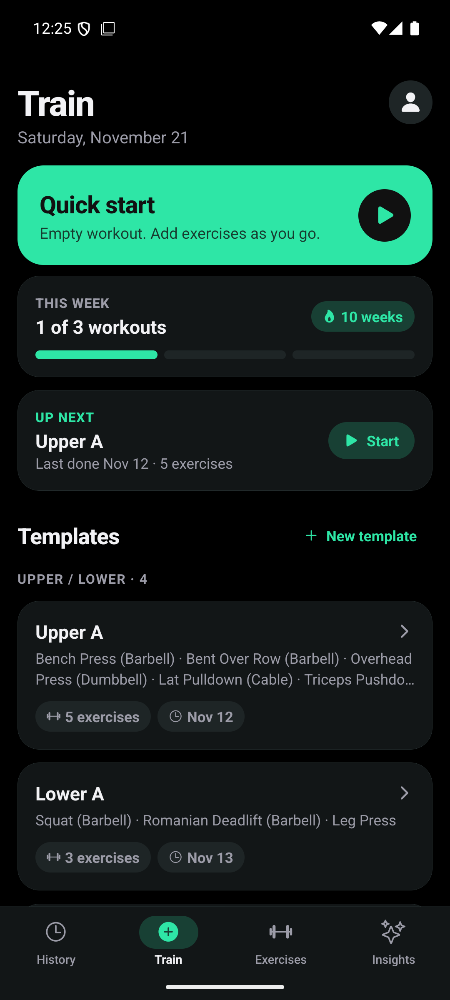
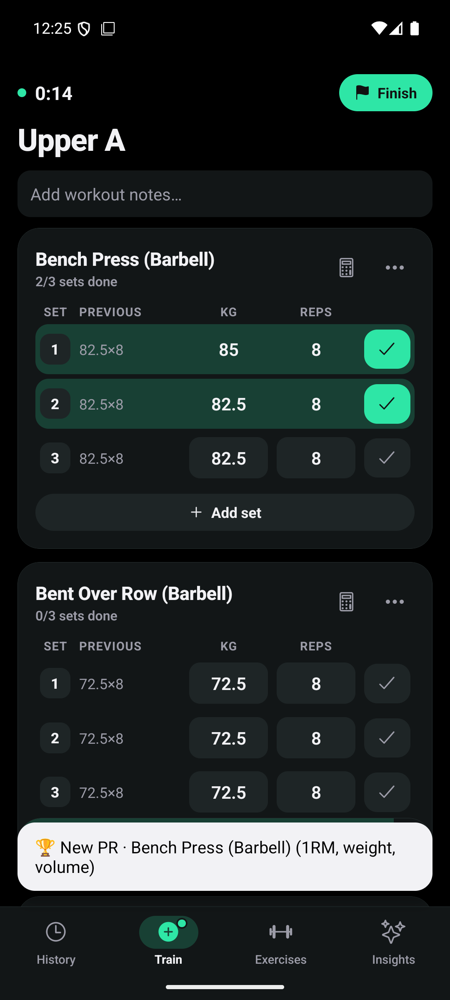
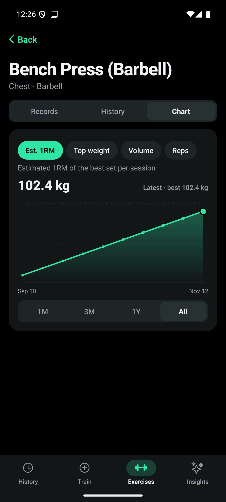
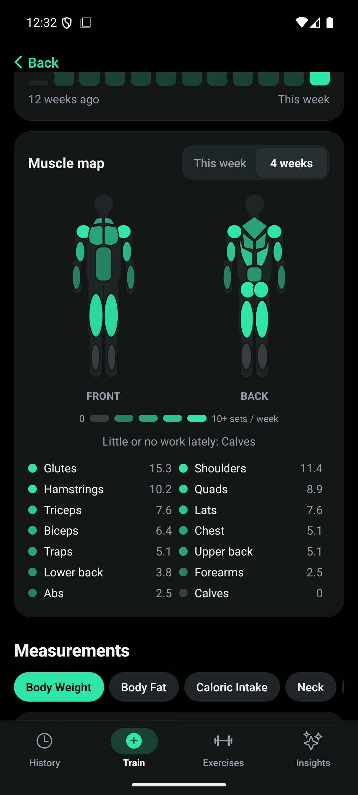

# Open Workouts

**A free, source-available, self-hostable strength training tracker.** Log workouts on your phone and keep the data on your own server.

The model is the fast "templates → live workout → history and PRs" loop that apps like Strong popularised. Open Workouts has no paywalls and no template limits, and it imports your existing Strong history.

- **Mobile app (iOS + Android, Expo/React Native): the main frontend.**
  - Offline-first; syncs whenever it can reach your server.
  - Also works in local-only mode with no server.
- **Web UI** served by the same container: log, review and import from any browser.
- **One container, one SQLite file.** Runs on Docker Compose, Kubernetes, or a Proxmox LXC.
- **Import and export** on mobile and web. Imports Strong CSVs (all three export variants). Exports a Strong-compatible CSV that imports back without duplicates, and a full JSON backup (workouts, templates, measurements and settings) that restores on any device.
- **Themes.** Light, dark and pure-black modes, eight accent colours, or any custom colour. Text contrast adjusts automatically so every choice stays readable.
- **AI insights (optional).** The AI part is optional:
  - **Built in:** weekly training updates pushed to your phone, "compare with previous workout", and questions about your training. Uses Claude or a local model (Ollama).
  - **Your own assistant:** Claude Desktop, Claude Code or another AI assistant can read your log through the built-in MCP server.

<p align="center">
  
  
  
  
</p>

<p align="center"><a href="docs/SCREENSHOTS.md">More screenshots: every screen of the app and the web UI</a></p>

## Features

| | |
|---|---|
| **Live workout logging** | Values pre-filled from last time, ± steppers, warm-up/drop/failure sets, RPE, notes, supersets, reorder and replace exercises, swipe to delete, PR alerts as you lift, rest timer that keeps running in the background, plate and warm-up calculators |
| **Templates** | Unlimited, with folders; build and edit them on the phone or the web; save or update one from a workout; suggested next template and repeat last workout |
| **Records** | Estimated 1RM (Brzycki), max weight, max set and session volume, rep records 1–12 with predictions, PR badges per set |
| **History & progress** | Calendar and search, per-workout summaries, a finish screen comparing with last time, progress charts with time ranges, weekly goal and streak (with a reminder before it breaks), a body map of sets per muscle |
| **Measurements** | Body weight, body fat, calories, 15 body circumferences. Log them all in one grouped form, see the latest value and monthly change at a glance, with charts |
| **Exercises** | 185 built-in, plus custom exercises (weight × reps, ± bodyweight, reps only, duration, cardio) |
| **AI insights** | Weekly reports with ntfy/Discord notifications, workout comparisons, Q&A, plateau detection; Claude or local LLMs; MCP server for your own assistant. See [docs/AI_INSIGHTS.md](docs/AI_INSIGHTS.md) |
| **Your data** | Works fully offline on the phone with no account; automatic daily backups on the phone; full backup and restore; sync status always visible |
| **Multi-user** | Accounts, per-device tokens you can revoke, API tokens, first user becomes admin |

## Quick start

```bash
git clone https://github.com/ernest-it/open-workouts.git && cd open-workouts
docker compose up -d
# open http://<host>:8080 and create your account
```

Then install the app from the [latest release](https://github.com/ernest-it/open-workouts/releases/latest) and enter `<host>:8080`, or your HTTPS domain if you expose it:

- **Android:** download and install the `.apk`.
- **iOS:** sideload the unsigned `.ipa` with AltStore or Sideloadly. There is no App Store build yet.

Prebuilt server images are at `ghcr.io/ernest-it/open-workouts:latest` (amd64 and arm64). For Kubernetes, Proxmox, reverse proxies and backups, see **[docs/DEPLOYMENT.md](docs/DEPLOYMENT.md)**.

## Development

Requires Node 22+.

```bash
npm install
npm test                 # shared + server test suites
npm run dev:server       # API on :8080 (tsx watch, data in ./data)
npm run dev:web          # web UI on :5173, proxies /api to :8080

cd apps/mobile && npm install
npx expo start           # scan the QR code with Expo Go, or press a / i for emulators
```

In the app, point it at your dev server's LAN IP, e.g. `http://192.168.1.20:8080`.

## Documentation

- [docs/STRONG_ANALYSIS.md](docs/STRONG_ANALYSIS.md): feature teardown of Strong (from public sources), the CSV format, and how we compare
- [docs/ALTERNATIVES.md](docs/ALTERNATIVES.md): survey of open-source trackers and exercise datasets; licensing notes
- [docs/ARCHITECTURE.md](docs/ARCHITECTURE.md): data model, sync protocol, REST API
- [docs/DEPLOYMENT.md](docs/DEPLOYMENT.md): Docker, Kubernetes, Proxmox, HTTPS, backups
- [docs/AI_INSIGHTS.md](docs/AI_INSIGHTS.md): LLM reports, weekly updates, MCP setup
- [docs/ROADMAP.md](docs/ROADMAP.md)
- [SECURITY.md](SECURITY.md): running a server safely, reporting vulnerabilities

## License

Open Workouts is **source-available** under the [PolyForm Noncommercial License 1.0.0](LICENSE).

- **Free for any non-commercial use:** use the app, self-host your own server, change the code, and share it non-commercially.
- **Commercial use needs a separate license.** That covers selling it, paid hosting, or using it to run a business.
- **A paid hosted sync service** is offered by the copyright holder for people who don't want to self-host.

See [LICENSING.md](LICENSING.md) for a plain-English summary, [CONTRIBUTING.md](CONTRIBUTING.md) for the contributor agreement, and [NOTICE.md](NOTICE.md) for third-party licenses.

Open Workouts is an independent project, not affiliated with or endorsed by Strong Fitness PTE. "Strong" is used only to describe import/export compatibility.
