# Screenshots

Demo data: 10 weeks of an upper/lower split, imported from a Strong CSV export. Android shots are from an Android 16 emulator (Pixel 7); web shots are 1280 × 800.

## Mobile app (Android)

### Logging a workout

| Start from a template | Live workout | Rest timer & plate calculator | Add exercise |
|---|---|---|---|
| 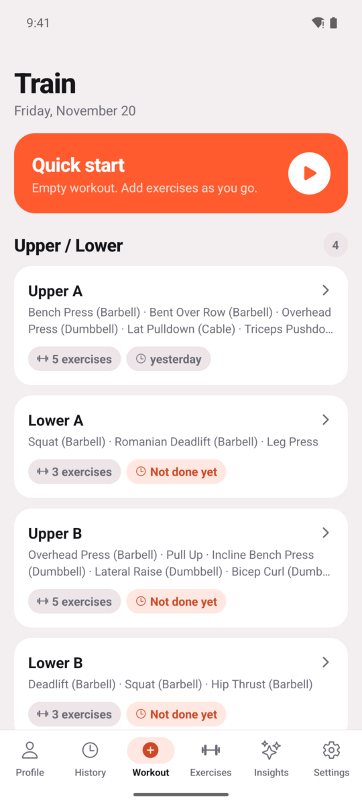 | 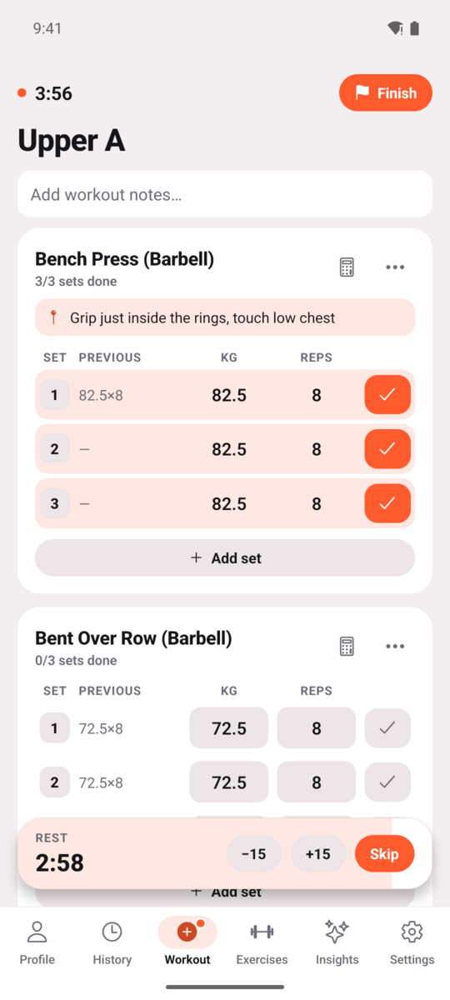 | 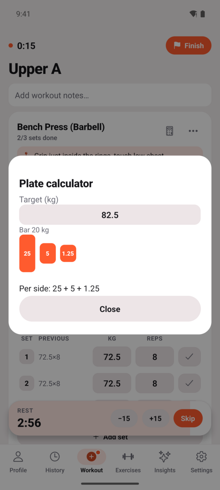 | 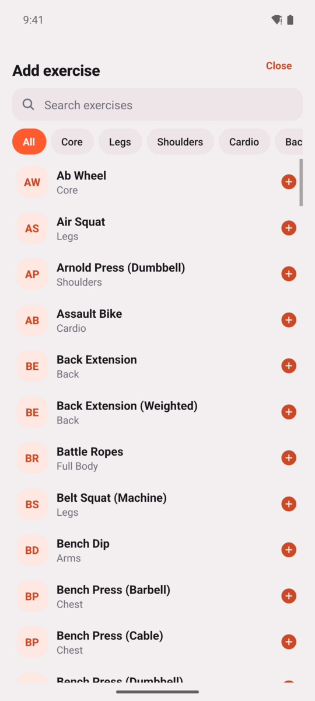 |

### History and progress

| History | Workout with PRs | Exercise records | Progress chart |
|---|---|---|---|
| 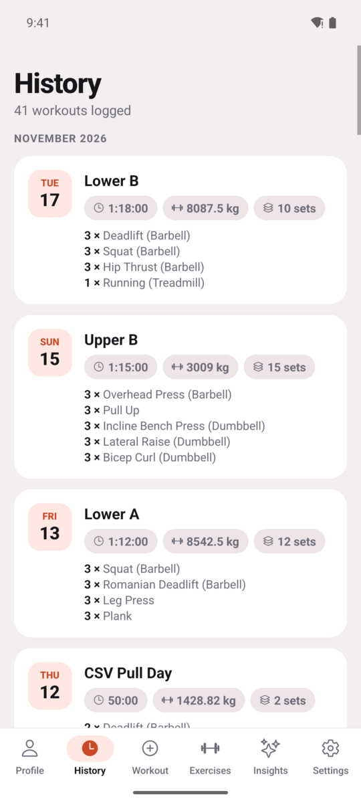 | 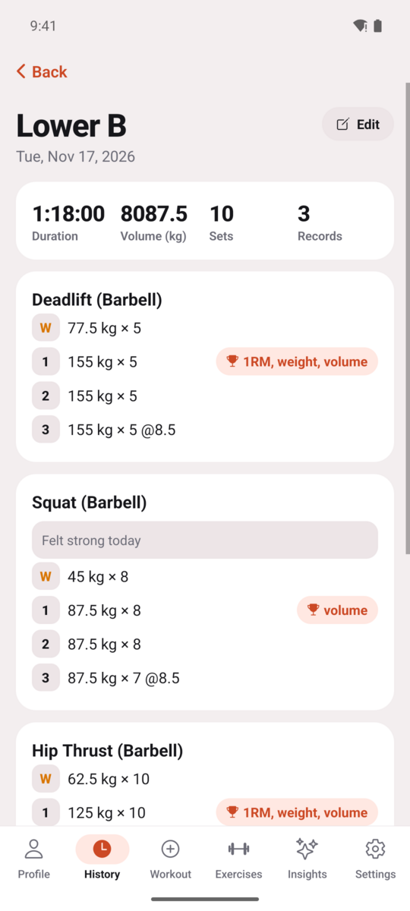 | 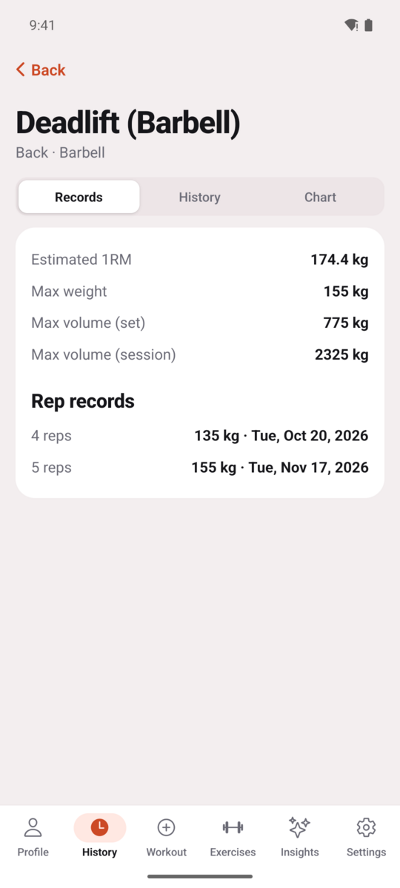 | 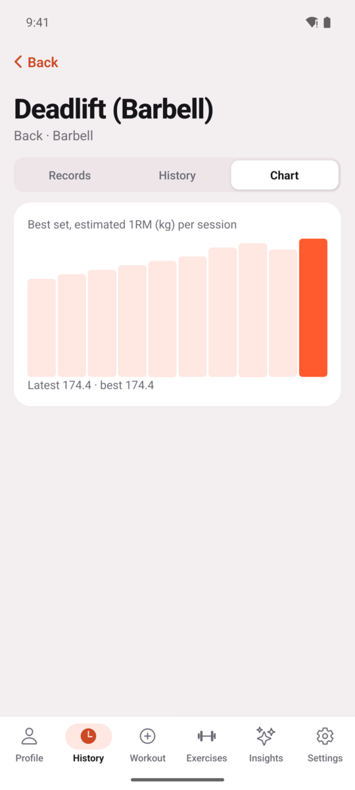 |

### Exercises, profile and themes

| Exercise library | Profile & measurements | Appearance settings | Black mode, Volt colour |
|---|---|---|---|
| 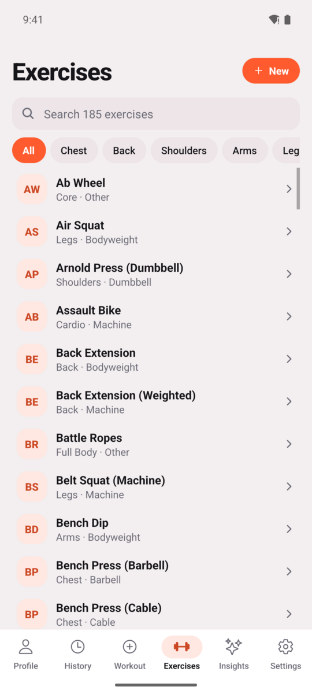 | 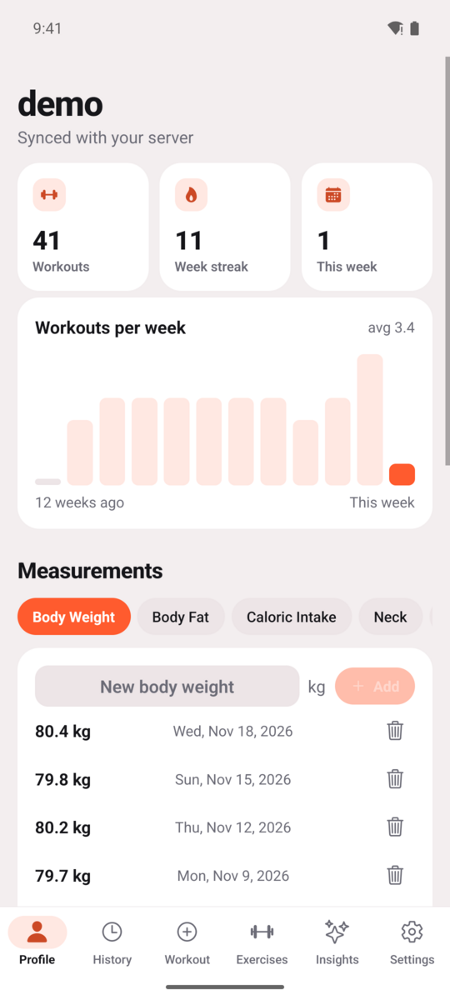 |  | 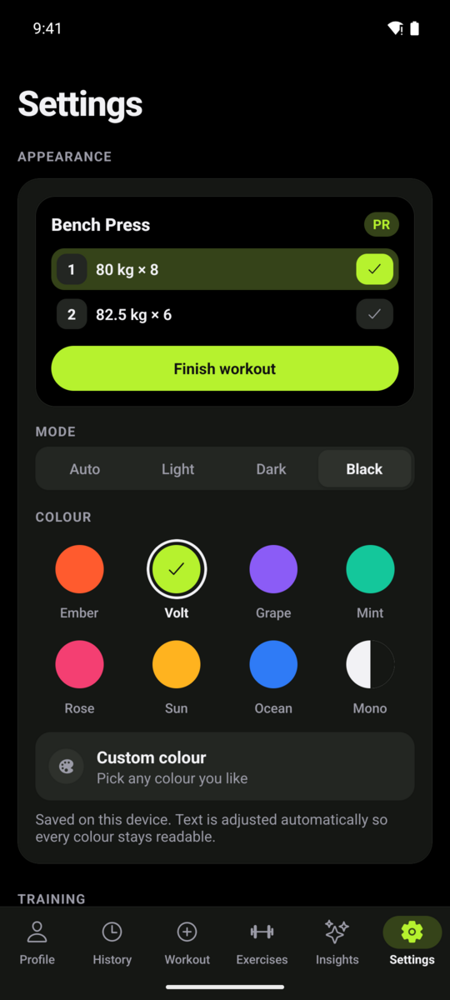 |

### Dark mode

Shown in the default Ember colour. Settings → Appearance has eight colours or any custom colour, in Light, Dark or Black.

| Live workout | History | Profile | Progress chart |
|---|---|---|---|
| 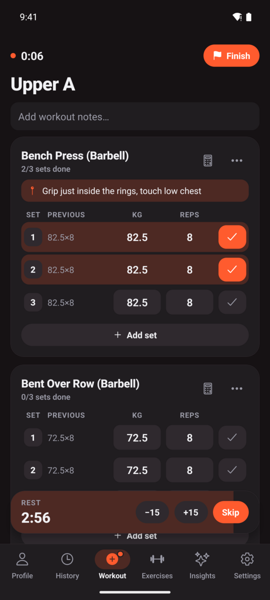 | 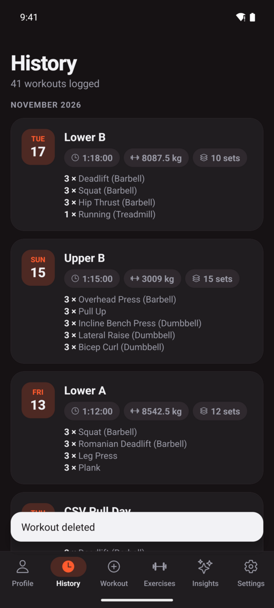 | 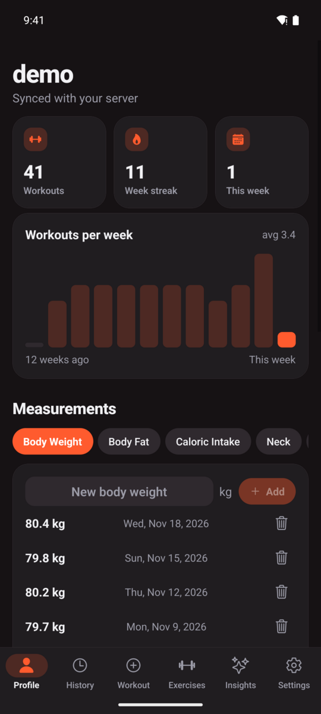 | 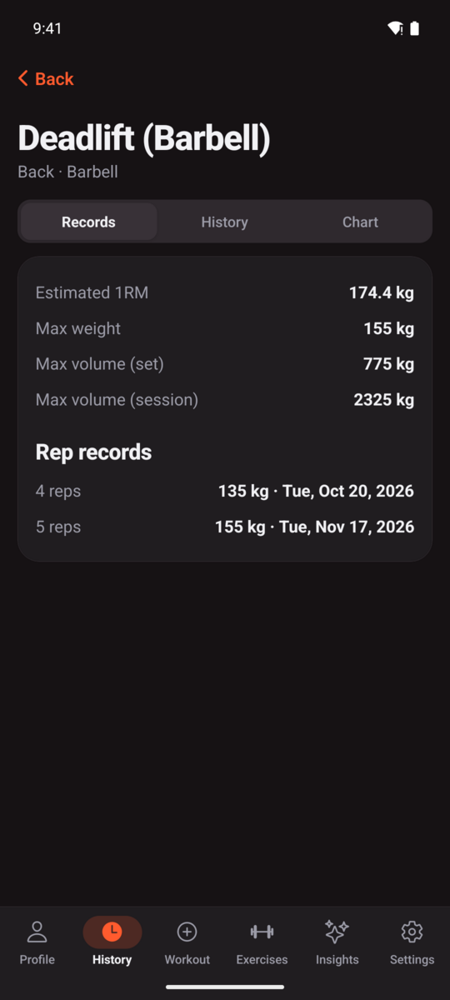 |

## Web UI

Served by the same container at `http://<host>:8080`.

**Start a workout**

**Live workout**

**History with calendar**

**Exercise records and rep-max predictions**

**Profile**
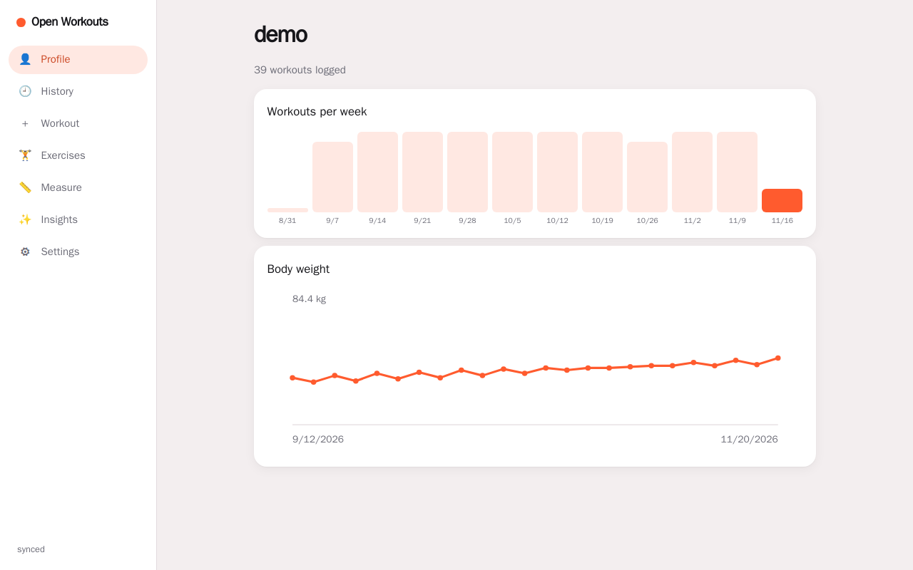

**Measurements**
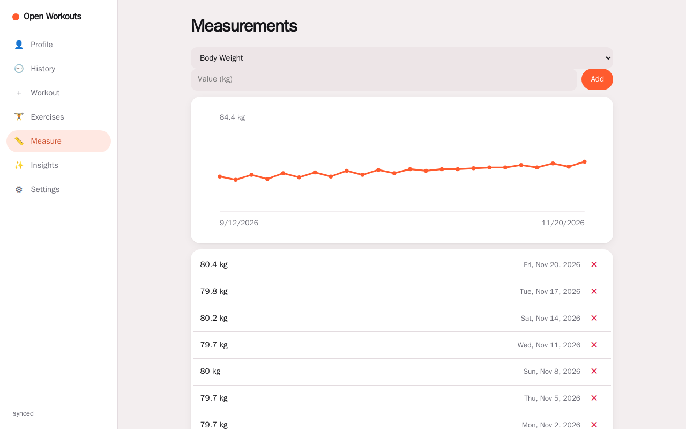

**Exercise library**

**Insights** (shown without an AI model configured; weekly updates and the MCP server for your own assistant)

**Settings** (appearance, units, import and export)

**Sign in**

**Dark mode**
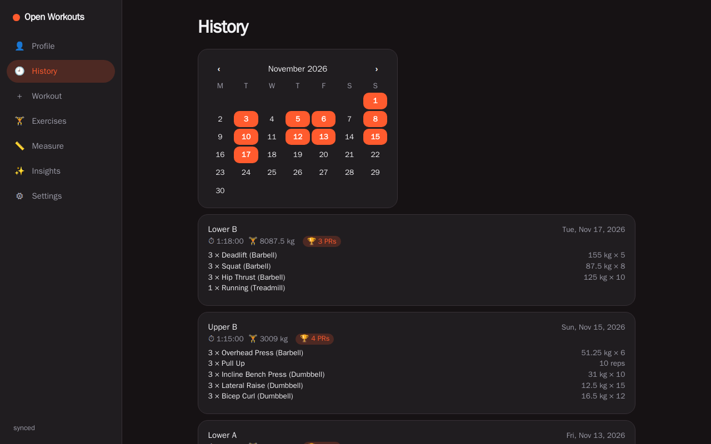
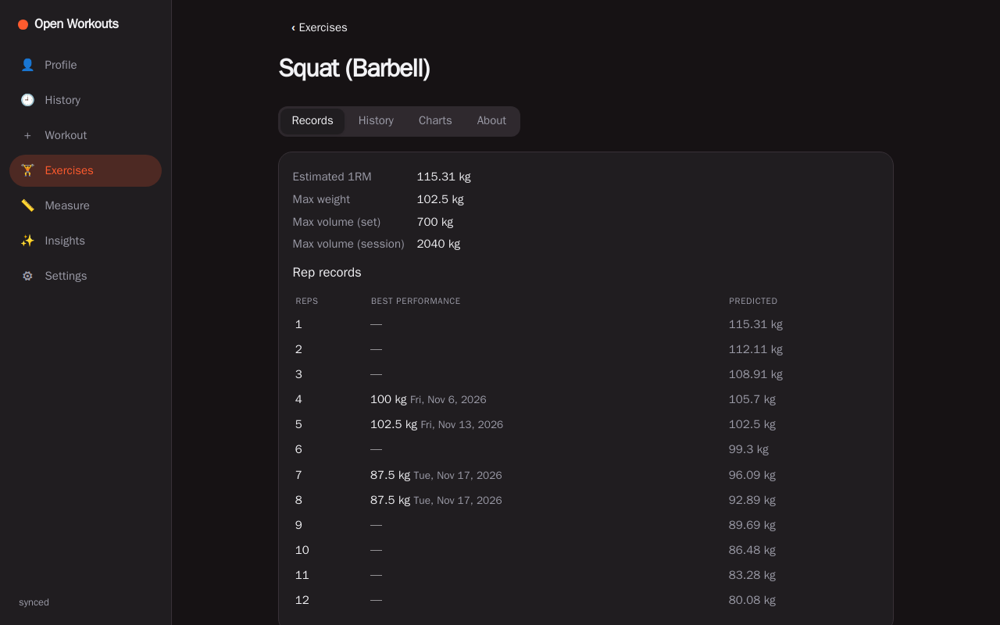
